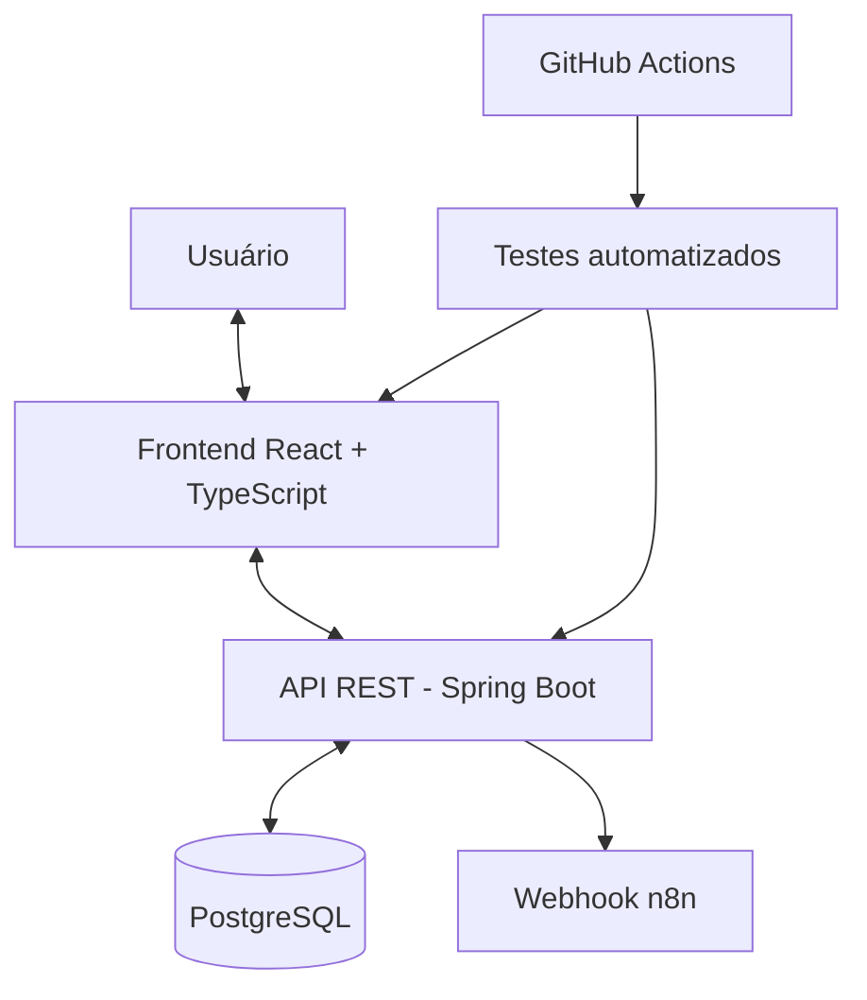
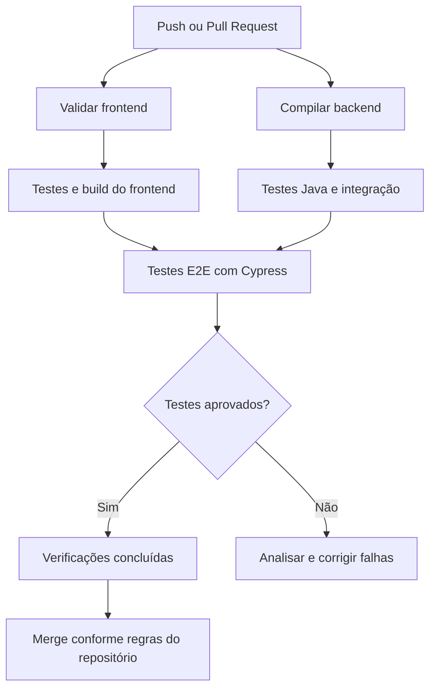

# 💪 FitSchedule — Gestão de Personal Trainers

<p align="center">
  <strong>Organização, agendamento e gestão de alunos em um só lugar.</strong>
</p>

<p align="center">
  
  
  
  
</p>

<p align="center">
  
  
  
  
</p>

---

## 📑 Navegação

- [📌 Sobre o projeto](#-sobre-o-projeto)
- [✨ Funcionalidades](#-funcionalidades)
- [🖥️ Demonstração visual](#️-demonstração-visual)
- [🛠️ Tecnologias](#️-tecnologias-utilizadas)
- [🏗️ Arquitetura](#️-arquitetura-da-aplicação)
- [🚀 Executando o projeto](#-como-executar-o-projeto)
- [🧪 Estratégia de testes](#-estratégia-de-qualidade-de-software)
- [🔄 CI/CD](#-cicd-com-github-actions)
- [🐳 Infraestrutura](#-docker-e-infraestrutura)
- [📈 Roadmap](#-roadmap-do-projeto)
- [📚 Documentação de QA](#-documentação-de-qa)
- [👨‍💻 Autor](#-autor)

---

## 📌 Sobre o projeto

O **FitSchedule** é uma aplicação web de gestão de alunos, personal trainers e agendamentos, desenvolvida como um **projeto de estudos com foco em desenvolvimento de software, qualidade e automação de testes**.

O objetivo principal é colocar em prática conhecimentos técnicos, explorar novas tecnologias e simular situações encontradas no dia a dia de equipes de desenvolvimento e QA.

Além de desenvolver as funcionalidades da aplicação, o projeto será utilizado para estudar e experimentar diferentes práticas e ferramentas, incluindo:

- 🧪 **Qualidade de software:** planejamento, criação e execução de casos de teste.
- 🤖 **Automação de testes:** desenvolvimento de testes E2E com Cypress e testes de API.
- 🔄 **CI/CD:** configuração de pipelines automatizados com GitHub Actions.
- ☕ **Desenvolvimento backend:** Java, Spring Boot e APIs REST.
- ⚛️ **Desenvolvimento frontend:** React, TypeScript e Vite.
- 🗄️ **Banco de dados:** PostgreSQL, SQL e versionamento de schema com Flyway.
- 🐳 **Infraestrutura:** Docker, Docker Compose e configuração de ambientes.
- 🖥️ **Servidores:** prática de implantação, configuração e manutenção de aplicações em servidor Linux.
- 🔗 **Integrações:** experimentação com webhooks e automações utilizando n8n.

### 🎯 Objetivo do projeto

Este projeto tem caráter **educacional e experimental**. As funcionalidades e tecnologias serão implementadas e aprimoradas gradualmente, conforme os estudos avançarem.

A proposta é documentar a evolução do FitSchedule, os desafios encontrados, as soluções desenvolvidas e os aprendizados adquiridos durante cada etapa.

O projeto também servirá como portfólio técnico, demonstrando na prática a aplicação de conceitos de desenvolvimento, testes automatizados, integração contínua e infraestrutura.

> 💡 **Aprender na prática, testar hipóteses, identificar problemas e evoluir continuamente.** Esse é o propósito do FitSchedule.

### 📊 Dashboard

- Visualização de indicadores de alunos cadastrados.
- Resumo de aulas futuras.
- Indicadores de agendamentos nas próximas 24 horas.
- Acesso rápido às principais funcionalidades.

### 👥 Gestão de alunos

- Cadastro de alunos.
- Listagem de alunos cadastrados.
- Edição de informações.
- Exclusão de registros.
- Exibição de informações cadastrais.

### 🏋️ Gestão de personal trainers

- Cadastro de profissionais.
- Listagem de profissionais.
- Edição e exclusão de registros.
- Exibição de informações de contato e status.

### 📅 Agendamentos

- Seleção de aluno.
- Definição de data e horário.
- Visualização das próximas aulas.
- Exclusão de agendamentos.
- Validação de conflitos de horários, conforme as regras implementadas.

### 🔗 Integração com n8n

- Configuração de URL de webhook.
- Envio de informações de agendamento via requisição HTTP POST.
- Possibilidade de integração com fluxos de lembretes e notificações.
- Preparação para automações externas.

---

## 🖥️ Demonstração visual

### Dashboard


### Gestão de alunos


### Gestão de personal trainers


### Agendamentos


### Configurações e integração com n8n


> 📷 As imagens devem ser adicionadas ao diretório `docs/images/` com os nomes indicados. Utilize dados fictícios nas capturas de tela antes de publicar o repositório.

---

## 🛠️ Tecnologias utilizadas

### Frontend

| Tecnologia | Utilização |
|---|---|
| React | Construção da interface |
| TypeScript | Tipagem estática |
| Vite | Ferramenta de desenvolvimento e build |
| TanStack Router / TanStack Start | Roteamento e recursos de aplicação, conforme configuração |
| Tailwind CSS | Estilização |
| Radix UI | Componentes de interface acessíveis |
| Lucide React | Ícones |
| date-fns | Manipulação de datas |

### Backend

| Tecnologia | Utilização |
|---|---|
| Java 21 | Linguagem de programação |
| Spring Boot 3.4.5 | Estrutura do backend |
| Spring Web | Desenvolvimento de APIs REST |
| Spring Data JPA | Persistência de dados |
| Hibernate | Mapeamento objeto-relacional |
| Spring Security Crypto | Recursos de criptografia de senhas |
| Maven | Gerenciamento de dependências e build |

### Banco de dados e infraestrutura

| Tecnologia | Utilização |
|---|---|
| PostgreSQL | Banco de dados relacional |
| Flyway | Versionamento de schema e migrations |
| Docker | Containerização |
| Docker Compose | Gerenciamento de serviços |
| DBeaver | Administração e consulta ao banco |
| n8n | Integração com automações externas |

### Qualidade e automação

| Tecnologia | Aplicação prevista |
|---|---|
| Cypress | Testes E2E e testes de API |
| JUnit | Testes unitários e de integração |
| Spring Boot Test | Testes do backend |
| GitHub Actions | Integração contínua e pipelines |
| Docker Compose | Ambientes de teste reproduzíveis |

*As tecnologias de automação e CI/CD serão marcadas como implementadas conforme forem configuradas e validadas no repositório.*

---

## 🏗️ Arquitetura da aplicação

A aplicação utiliza uma arquitetura web com frontend, backend REST e banco de dados relacional.



### Fluxo de funcionamento

1. O usuário interage com a interface web.
2. O frontend realiza requisições para a API.
3. O backend processa as solicitações e aplica as regras de negócio.
4. O Spring Data JPA e o Hibernate realizam a persistência no PostgreSQL.
5. O Flyway gerencia as alterações estruturais do banco.
6. Os agendamentos podem acionar integrações externas por meio do n8n.

Os detalhes de autenticação, autorização e comunicação entre os componentes dependem da implementação atual.

---


## 🧪 Estratégia de qualidade de software

A qualidade será trabalhada em diferentes níveis, priorizando os fluxos mais importantes para o negócio.

### Testes funcionais

| Área | Cenários principais |
|---|---|
| Alunos | Cadastro válido, campos obrigatórios, edição e exclusão |
| Personal trainers | Cadastro, edição, exclusão e validações |
| Agendamentos | Criação, datas inválidas, horários e conflitos |
| Dashboard | Atualização dos indicadores após operações |
| Integração n8n | Payload enviado, falhas HTTP e tratamento de erros |

### Testes de API

Os testes deverão validar:

- Códigos de resposta HTTP.
- Estrutura e conteúdo do JSON.
- Campos obrigatórios e dados inválidos.
- Regras de negócio.
- Persistência e consistência dos dados.
- Tratamento de erros.
- Autenticação e autorização, conforme implementadas.

### Testes de integração

Serão utilizados para verificar a interação entre os componentes do Spring Boot, as regras de negócio e o PostgreSQL.

O ambiente de teste deverá ser isolado para evitar interferências nos dados de desenvolvimento.

### Automação E2E com Cypress

O Cypress será utilizado para automatizar jornadas completas da aplicação.

Exemplo ilustrativo de teste:

```typescript
describe('Gestão de alunos', () => {
  it('deve exibir a tela de alunos', () => {
    cy.visit('/alunos');

    cy.contains('Alunos').should('be.visible');
  });
});
```

O exemplo deverá ser adaptado às rotas reais e aos requisitos de autenticação da aplicação.

---

## 🔄 CI/CD com GitHub Actions

Uma das etapas de evolução do projeto é implementar um pipeline de integração contínua para executar verificações automaticamente a cada Pull Request.

### Fluxo planejado



### Objetivos

- Automatizar a compilação do frontend e backend.
- Executar testes unitários e de integração.
- Executar testes E2E em ambiente controlado.
- Disponibilizar relatórios de execução.
- Identificar regressões antes do merge.
- Preparar o processo de deploy.

Os workflows serão documentados em `.github/workflows/` após sua implementação.

---

## 🐳 Docker e infraestrutura

Além do ambiente de desenvolvimento, o projeto será utilizado para praticar a configuração e a manutenção de aplicações em servidor.

### Evoluções previstas

- Containerização dos serviços.
- Configuração de redes entre containers.
- Separação dos ambientes de desenvolvimento, teste e produção.
- Gerenciamento seguro de variáveis de ambiente.
- Configuração de proxy reverso e HTTPS.
- Administração de servidor Linux.
- Análise de logs e diagnóstico de falhas.
- Estratégia de backup e recuperação do PostgreSQL.
- Implantação controlada por pipeline.

O objetivo é compreender o ciclo completo: desenvolvimento, validação, publicação e manutenção.

---

## 📈 Roadmap do projeto

A evolução será acompanhada por etapas.

### 🟢 Aplicação

- [x] Criar a interface inicial do dashboard.
- [x] Desenvolver telas de alunos e personal trainers.
- [x] Desenvolver a tela de agendamentos.
- [x] Criar tela de configuração do webhook n8n.
- [ ] Revisar e documentar todas as regras de negócio.

### 🧪 Qualidade e automação

- [ ] Elaborar plano de testes.
- [ ] Criar matriz de riscos.
- [ ] Mapear os endpoints da API.
- [ ] Implementar testes E2E com Cypress.
- [ ] Implementar testes de API.
- [ ] Criar testes unitários e de integração no backend.
- [ ] Publicar relatórios de execução.

### 🔄 CI/CD e infraestrutura

- [ ] Configurar GitHub Actions.
- [ ] Executar testes automaticamente em Pull Requests.
- [ ] Padronizar ambientes com Docker Compose.
- [ ] Configurar deploy controlado.
- [ ] Documentar a implantação em servidor Linux.
- [ ] Implementar monitoramento e estratégia de backups.

> O roadmap será atualizado conforme as entregas forem concluídas e verificadas.

---

## 📚 Documentação de QA

A documentação de qualidade será organizada para registrar o planejamento, a execução e os resultados dos testes.

```text
docs/
├── images/
│   ├── dashboard.png
│   ├── alunos.png
│   ├── personais.png
│   ├── agendamentos.png
│   └── configuracoes.png
├── test-plan.md
├── test-cases.md
├── risk-matrix.md
├── bug-reports.md
├── api-testing.md
├── automation-strategy.md
└── deployment.md
```

Os documentos serão adicionados à medida que cada etapa for desenvolvida.

---

## 🔐 Segurança

- Utilizar dados fictícios nos testes e nas demonstrações.
- Nunca versionar senhas, tokens ou credenciais reais.
- Não publicar URLs privadas de webhooks.
- Manter os ambientes de teste separados dos ambientes de produção.
- Restringir o acesso ao banco de dados.
- Configurar segredos sensíveis por mecanismos apropriados.
- Revisar permissões e configurações antes de disponibilizar a aplicação publicamente.

---

## 📈 Acompanhe a evolução do projeto

O FitSchedule está em desenvolvimento contínuo, com foco na evolução da aplicação, qualidade de software e automação de testes.

Neste repositório, você poderá acompanhar a implementação de novas funcionalidades, a criação de cenários de teste, a configuração de pipelines CI/CD e os desafios técnicos encontrados durante o desenvolvimento.

### 🚀 Próximas etapas

- [ ] Estruturar a estratégia de testes.
- [ ] Automatizar os principais fluxos com Cypress.
- [ ] Implementar testes de API.
- [ ] Configurar integração contínua com GitHub Actions.
- [ ] Preparar o ambiente com Docker.
- [ ] Implantar a aplicação em um servidor Linux.

### 💬 Vamos trocar experiências?

Se você trabalha com QA, automação de testes, desenvolvimento ou DevOps, fique à vontade para acompanhar o projeto e trocar experiências.

⭐ Se o projeto despertar seu interesse, deixe uma estrela no repositório!

🔗 [Acompanhe meus projetos no GitHub](https://github.com/vitorbatista2)

---

## 👨‍💻 Autor

**Vítor de Paula Batista**

Profissional de qualidade de software, desenvolvendo projetos práticos para aprofundar conhecimentos em testes, automação, desenvolvimento e infraestrutura.

- 💻 GitHub: [@vitorbatista2](https://github.com/vitorbatista2)
- 🚀 Projeto: FitSchedule

---

<p align="center">
  <strong>🚀 Desenvolvendo. Testando. Automatizando. Evoluindo.</strong>
</p>

<p align="center">
  <sub>FitSchedule — Personal Trainer Management System</sub>
</p>
